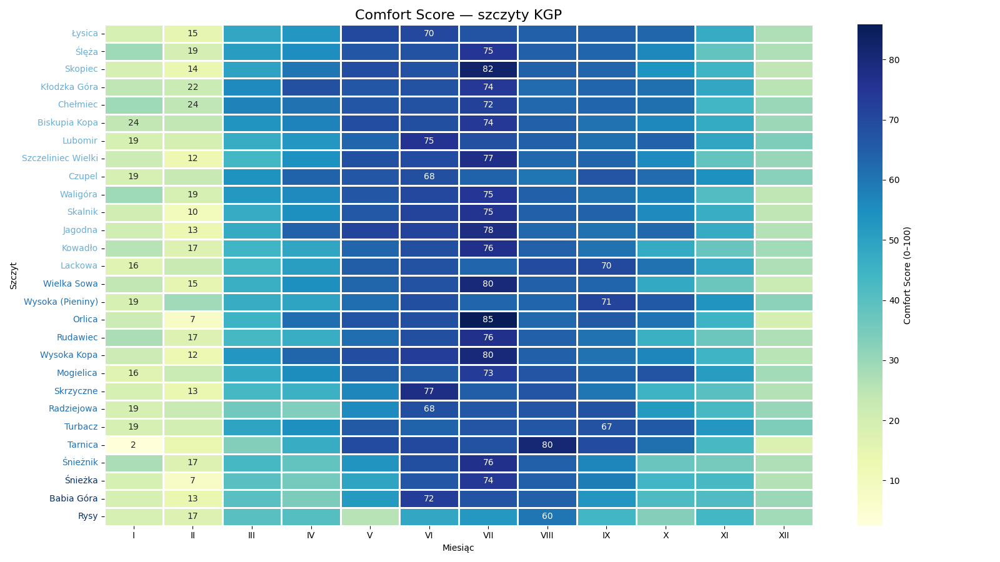
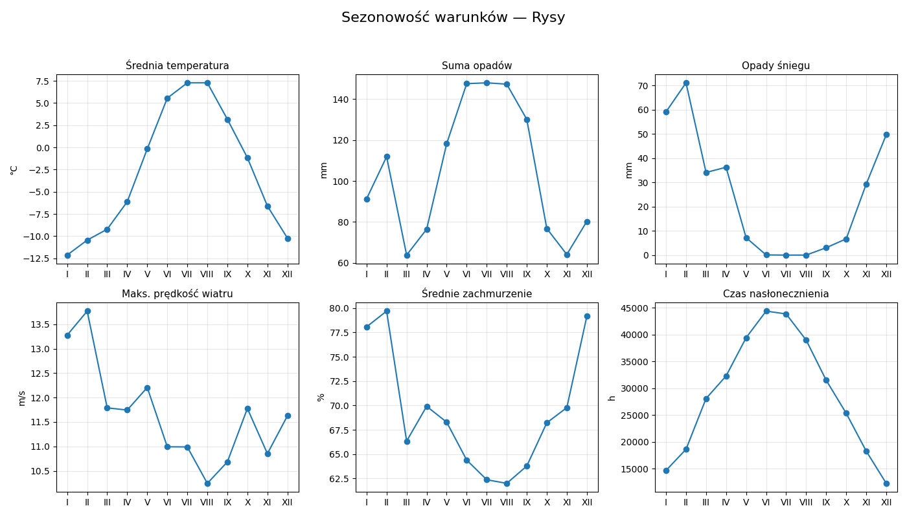
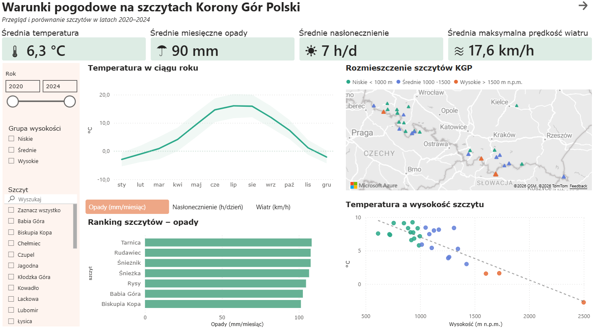
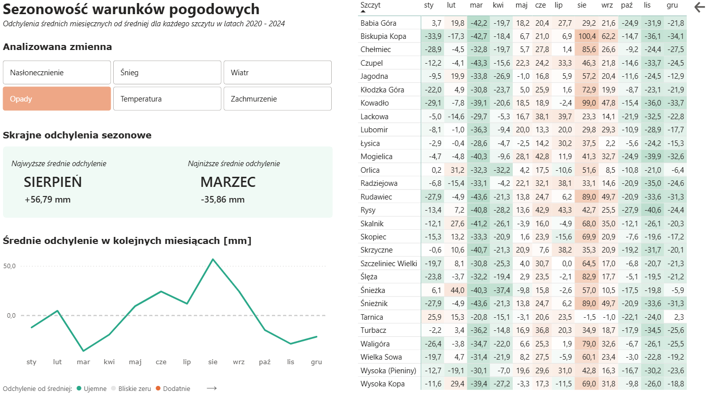

# Analiza warunków pogodowych Korony Gór Polski (2020–2024)

# Opis projektu

Projekt obejmuje analizę warunków pogodowych na 28 szczytach Korony Gór Polski (KGP) w latach 2020–2024. Na podstawie danych z Open-Meteo, przetworzonych i przeanalizowanych w Pythonie, porównano temperaturę, opady, wiatr, zachmurzenie i nasłonecznienie w różnych regionach i grupach wysokościowych.

Celem projektu było rozpoznanie sezonowości warunków pogodowych, wskazanie szczytów o najbardziej wymagających warunkach oraz ocena, które miesiące mogą sprzyjać górskim wędrówkom. Wyniki zaprezentowano na wykresach oraz w interaktywnym dashboardzie Power BI, umożliwiającym porównywanie szczytów i analizę odchyleń sezonowych.

# Cele analizy

1.	Określenie najbardziej deszczowych miesięcy dla poszczególnych szczytów.
2.	Analiza sezonowości temperatur, opadów, wiatru i pozostałych parametrów pogodowych.
3.	Porównanie różnic między regionami (Tatry, Sudety, Beskidy, Góry Świętokrzyskie, Pieniny).
4.	Porównanie szczytów w grupach wysokościowych (<1000 m, 1000–1500 m, >1500 m).
5.	Wskazanie szczytów o najbardziej wymagających warunkach pogodowych.
6.	Wyciągnięcie praktycznych wniosków przydatnych przy planowaniu wycieczek.
7. Udostępnienie wyników w interaktywnym raporcie Power BI.

# Dane

- Źródło: Open-Meteo API
- Okres analizy: 2020–2024
- Zakres: 28 szczytów Korony Gór Polski.
- Agregacja: dane dobowe przekształcone do wartości miesięcznych
- Zmienne: średnia, minimalna i maksymalna temperatura dobowa (°C), suma opadów (mm), opad śniegu (cm), maksymalna dobowa prędkość wiatru (km/h), czas nasłonecznienia i zachmurzenie (%)

Dane Open-Meteo mają charakter siatkowy, co oznacza, że wartości pogodowe są wyznaczane na podstawie interpolacji z modeli numerycznych w regularnych punktach siatki, a nie pochodzą bezpośrednio ze stacji pomiarowych, co może wpływać na ich dokładność.
Dla Śnieżki, jedynego szczytu KGP na którym znajduje się obserwatorium meteorologiczne, przeprowadzono porównanie danych siatkowych Open-Meteo z danymi stacyjnymi IMGW. W badanym okresie średnia różnica wyniosła –0,41°C. Wartość błędu RMSE, czyli przeciętne odchylenie wartości siatkowych od pomiarów stacyjnych, wynosiło około 1,4°C. Na tej podstawie uznano, że nie ma potrzeby stosowania korekty temperatur dla wszystkich szczytów i dane Open-Meteo można uznać za wystarczająco wiarygodne do celów projektu.

# Metody i narzędzia 

- Python (pandas, requests, matplotlib): pobranie danych z API, przygotowanie miesięcznych agregacji, porównania i wizualizacje.
- Analiza danych: profile pogodowe szczytów, sezonowość, rankingi, porównania regionów i grup wysokościowych oraz wskaźnik komfortu.
- Power BI i DAX: interaktywny raport z filtrami, dynamicznymi miarami, rankingami i heatmapą odchyleń sezonowych.

# Wnioski z analizy

Analiza umożliwiła opracowanie profilu pogodowego każdego z 28 szczytów, porównanie regionów i grup wysokościowych oraz przygotowanie rankingów najbardziej deszczowych, wietrznych i zimnych szczytów. Najważniejsze wyniki przedstawiono poniżej.

### 1. Heatmapa wskaźnika komfortu

Wskaźnik komfortu został zbudowany w oparciu o cztery elementy:
- średnia temperatura (najwyższy komfort przy wartościach umiarkowanych, ok. 10–20°C),
- suma opadów (niższe opady oznaczają wyższy komfort),
- prędkość wiatru (najwyższy komfort przy niskich wartościach),
- zachmurzenie (średnie wartości uznane za najbardziej korzystne).

Wszystkie zmienne zostały przeskalowane do wspólnej skali 0–100, a następnie połączone z równymi wagami. W ten sposób powstał syntetyczny wskaźnik komfortu wyznaczony osobno dla każdego szczytu i miesiąca.

  

- Najbardziej komfortowe warunki w latach 2020–2024 występowały na szczytach niskich i średnich – najwyższe średnie wartości wskaźnika osiągnęły Chełmiec, Kłodzka Góra, Czupel, Biskupia Kopa i Turbacz.
- Szczyty wysokie (Rysy, Śnieżka, Babia Góra) osiągały wyraźnie niższe wartości wskaźnika.
- Najkorzystniej wypadł lipiec; wysokie wartości występowały również w czerwcu i sierpniu. Najtrudniejsze warunki według przyjętej metody pojawiały się zimą, szczególnie w lutym.

---

### 2. Porównanie regionów i grup wysokościowych
  
  
- Szczyty wysokie są przeciętnie zimniejsze i bardziej wilgotne, natomiast na średnich wysokościach występowały warunki korzystniejsze według przyjętego wskaźnika komfortu.
- Przebieg roczny temperatury jest podobny we wszystkich regionach i grupach wysokościowych: wzrost od stycznia do lipca i spadek od sierpnia do grudnia. Różnice między regionami polegają głównie na poziomie temperatury (Tatry najchłodniejsze, Góry Świętokrzyskie i Pieniny najcieplejsze).
- Opady są najwyższe od czerwca do sierpnia i najniższe w marcu–kwietniu. Sezonowy cykl jest podobny we wszystkich regionach i grupach wysokościowych, ale Tatry notują wyższy poziom opadów niż pozostałe pasma.

---

### 3. Roczny cykl pogodowy na przykładzie Rysów
  

- Temperatura: średnia roczna ma typowy przebieg – najniższe wartości zimą (–10 do –12°C w styczniu i lutym), a najwyższe latem (ok. 7°C w lipcu).
- Opady: największe sumy notowane są latem (ponad 140 mm w czerwcu–sierpniu), a najmniejsze wczesną wiosną (marzec–kwiecień).
- Opady śniegu: dominują zimą (grudzień–marzec, ponad 50–100 mm miesięcznie), zanikają całkowicie jedynie w lipcu i sierpniu.
- Wiatr: średnia z dobowych maksymalnych prędkości wiatru wynosiła w zależności od miesiąca około 10–14 km/h.
- Zachmurzenie: najwyższe w zimie (80–85%), najniższe latem (ok. 60%).
- Nasłonecznienie: maksimum przypada na maj–lipiec (ponad 40 000 h w skali miesiąca w danych siatkowych), najniższe wartości są zimą.

Podsumowanie: Rysy wyróżniają się niskimi temperaturami i znacznymi opadami. Lipiec oferuje najłagodniejsze warunki temperaturowe, ale nawet wtedy średnia temperatura wynosi około 7°C.

---

### 4. Ranking warunków pogodowych

| Kategoria                      | 1 miejsce        | 2 miejsce        | 3 miejsce        |
|--------------------------------|------------------|------------------|------------------|
| **Najbardziej deszczowe (mm)** | Tarnica (108.3)  | Rudawiec (107.7) | Śnieżnik (107.7) |
| **Najbardziej śnieżne (cm)**   | Rysy (24.7)      | Śnieżka (20.1)   | Tarnica (19.8)   |
| **Najbardziej wietrzne (km/h)** | Chełmiec (22.3)  | Waligóra (20.9)  | Ślęża (20.1)     |
| **Najbardziej słoneczne (h)**  | Rysy (28976.2)   | Radziejowa (27551.8) | Ślęża (27297.1) |
| **Najbardziej pochmurne (%)**  | Śnieżka (73.2)   | Rudawiec (72.0)  | Śnieżnik (72.0)  |
| **Najcieplejsze (°C)**         | Czupel (9.2)     | Kłodzka Góra (9.1) | Chełmiec (9.1)   |
| **Najzimniejsze (°C)**         | Rysy (–2.7)      | Śnieżka (1.6)    | Babia Góra (1.6) |

# Dashboard Power BI

Uzupełnieniem analizy wykonanej w Pythonie jest dwustronicowy, interaktywny dashboard Power BI. Umożliwia porównywanie warunków pogodowych na szczytach oraz analizę ich sezonowości w latach 2020–2024.

**[📊 Pobierz dashboard Power BI](dashboard/Dashboard%20-%20pogoda.pbix)**

1. Przegląd warunków pogodowych

Pierwsza strona prezentuje ogólny obraz warunków na szczytach KGP:
- karty KPI ze średnią temperaturą, średnimi miesięcznymi opadami, średnim dziennym nasłonecznieniem i średnią z maksymalnych dobowych prędkości wiatru,
- roczny przebieg temperatury z pasmem średnich minimów i maksimów dobowych,
- mapę lokalizacji szczytów z rozróżnieniem grup wysokościowych,
- przełączany ranking TOP 7 dla opadów, nasłonecznienia i wiatru,
- wykres zależności między wysokością szczytu a temperaturą z linią trendu.

Raport umożliwia filtrowanie danych według zakresu lat, grupy wysokościowej i szczytu. 

3. Sezonowość warunków pogodowych

Druga strona pozwala analizować odchylenia średnich wartości miesięcznych od średniej dla danego szczytu. Obejmuje:
- przełącznik sześciu parametrów: temperatury, opadów, śniegu, wiatru, nasłonecznienia i zachmurzenia,
- karty wskazujące miesiące o najwyższych i najniższych średnich odchyleniach,
- wykres liniowy średnich odchyleń w kolejnych miesiącach,
- heatmapę do porównywania wzorców sezonowych pomiędzy wszystkimi 28 szczytami,
- tooltipy prezentujące wartości i punkt odniesienia dla obliczonych odchyleń.

Odchylenia służą tutaj do opisu sezonowości, a nie anomalii względem wieloletniej normy klimatycznej.
